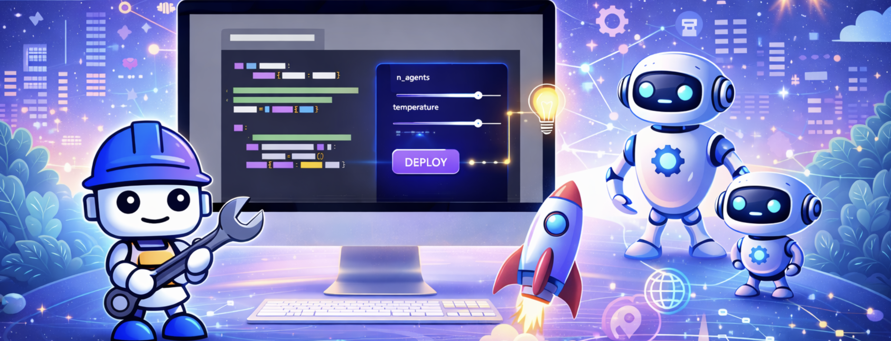

# Bob-a-thon Workshop



TechXchange 2026 Labs demonstrating how to integrate [IBM Bob](https://bob.ibm.com) into CI/CD pipelines, to inject AI across the development delivery processes.


## Getting Started

**All participants must complete setup first:**

1. **📋 [Prerequisites](PREREQUISITES.md)** — Ensure you have the requirements and initial configuration for the labs.
2. **Run through the [labs](labs/)** - Series of labs around Bob and the CI pipeline.
3. **Optional:** Explore [Handoff Labs](labs/handoff-labs/) for advanced scenarios after completing the labs

---

## Workshop Structure

### 🏗️ [Labs](labs/) — Jenkins Pipeline Integration

**Duration:** 1 - 5 hours | **Level:** Intermediate to Advanced

Build a complete Jenkins pipeline with Bob integration across 5 progressive labs:

1. **PR / Git Diff Review** — Bob analyzes diffs, identifies risks, provides summaries
2. **Unit Testing** — Generate tests, diagnose failures, add pipeline test stages
3. **Security Scanning** — Run security scans, Bob analyzes vulnerabilities
4. **Linting** — Run linters, Bob analyzes findings and posts PR comments
5. **Jenkins Pipeline Insights with MCP** — Configure the Jenkins MCP server to interact with your Jenkins instance directly from Bob

**Prerequisites:** Jenkins access, basic pipeline knowledge. Complete [`labs/lab0/SETUP.md`](labs/lab0/SETUP.md) before starting Lab 1.

### Pipeline Scaffolding

The labs can be built to use a progressive Jenkinsfile approach where you build up the pipeline stage by stage. For the purposes of demonstration and to save time, we will build and run the individual stages at each lab.

**How it works:** Each pipeline build spins up a Kubernetes pod with multiple side car containers:

- **`jenkins-agent`** — Runs pipeline shell steps (builds, tests, scans, lints)
- **`bob-cli`** — Runs Bob CLI when invoked via `container('bob-cli') { ... }`
- **`linting-tools`** — Contains all the linting tools used by the linting lab.

The containers share an `emptyDir` workspace volume at `/workspace`. When the pipeline does `checkout scm`, the repo lands there, and Bob reads `.bob/custom_modes.yaml` directly from it — so any mode on your branch is available at pipeline runtime without rebuilding images.

---

### 🚀 [Handoff Labs](labs/handoff-labs/) — Additional Scenarios

**Duration:** 30 min - 3+ hours | **Level:** Intermediate to Advanced | **Optional / After completing the workshop labs**

Advanced labs for specialized use cases and extending Bob's capabilities:

- **Bob Mode Builder** — Create custom Bob modes for your workflows (includes 5 examples + templates)
- **Example MCP Servers** — 5 production-ready MCP server implementations using FastMCP
- **OpenShift Operations** — Manage OpenShift clusters using Bob's AI-native approach
- **Python to JavaScript Translation** — Translate code between programming languages
- **Simple App Development** — Build a full-stack application from scratch with Bob

**For:** Teams with specific integration requirements or those wanting to customize Bob for their workflows.

---

## Repository Layout

```text
├── labs/
│   ├── lab0                 Participant setup (SETUP.md: Jenkins pipeline + working branch)
│   ├── lab1 … lab5          Jenkins pipeline integration labs
│   └── handoff-labs/        Advanced scenarios and custom modes (6 labs)
│
├── order-service/           Spring Boot demo app (used in the labs)
├── Jenkinsfile              Base pipeline (labs starting point)
├── .bob/                    Bob configuration (modes, MCP servers)
└── PREREQUISITES.md         System requirements and dependencies
```

---

## Support & Resources

- **Lab-specific questions:** Check the troubleshooting section in each lab
- **Bob documentation:** https://bob.ibm.com/docs
- **Quick references:** Most labs include Quick Start guides for common prompts
