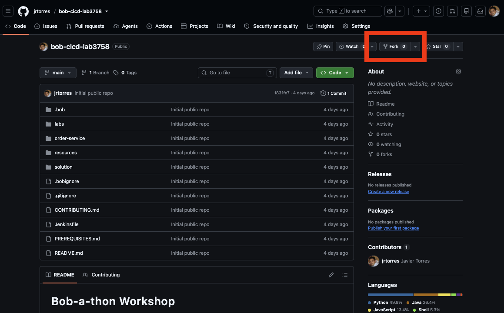
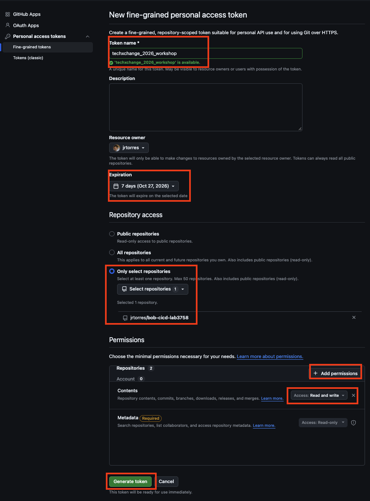

# Lab 0 — Participant Setup

Before you start Lab 1, set up **one Jenkins pipeline** that you'll reuse across all five labs. Each lab adds a new stage to `Jenkinsfile` on your branch; you push, click **Build Now**, and watch Bob do its thing.

## Table of Contents

- [Prerequisites](#prerequisites)
- [What your instructor should have given you](#what-your-instructor-should-have-given-you)
- [Step 1 — Fork the repository, set up Git access, and create your branch](#step-1--fork-the-repository-set-up-git-access-and-create-your-branch)
  - [1a. Fork the repository](#1a-fork-the-repository)
  - [1b. Create a GitHub PAT for your fork](#1b-create-a-github-pat-for-your-fork)
  - [1c. Clone your fork](#1c-clone-your-fork)
  - [1d. Open in Bob IDE](#1d-open-in-bob-ide)
  - [1e. Configure Git (if needed)](#1e-configure-git-if-needed)
- [Step 2 — Create your Jenkins pipeline](#step-2--create-your-jenkins-pipeline)
- [Step 3 — Run it once to verify](#step-3--run-it-once-to-verify)
- [You're set — the workflow from here](#youre-set--the-workflow-from-here)
- [Stuck?](#stuck)

## Prerequisites

Before starting, complete the [Prerequisites](../../PREREQUISITES.md) checklist. You should at a minimum have: 

- Git installed and configured (Provided by lab environment)
- Bob IDE installed (Provided by lab environment)
- GitHub account

### What your instructor should have given you

- [ ] **Jenkins URL** (e.g., `https://jenkins-jenkins.<cluster>.techzone.ibm.com`)
- [ ] **Jenkins username** — something like `user1`
- [ ] **Jenkins password** 
- [ ] **Git repo URL** — the public repo where this workshop's code lives (you'll fork it)

## Step 1 — Fork the repository, set up Git access, and create your branch

### 1a. Fork the repository

Your instructor will provide the repository URL for this workshop. Complete the following steps to fork your own copy of this repository:

1. Navigate to the repository URL provided by your instructor
2. Click the **Fork** button in the top-right corner
3. Select your account or organization as the destination
4. Wait for the fork to complete



### 1b. Create a GitHub PAT for your fork

You need a GitHub Personal Access Token (PAT) to authenticate when you `git push` your changes to your fork. To do this, you will create a **fine-grained** token limited to your fork, so it can't touch any of your other repositories. 

> **Note:** Your fork must already exist (1a), because you select it from a list.



1. Go to `https://github.com/settings/personal-access-tokens/new` (or **Settings → Developer settings → Personal access tokens → Fine-grained tokens → Generate new token**)
2. Set:
   - **Token name:** `techxchange_2026_workshop`
   - **Resource owner:** your own account
   - **Expiration:** 7 days
   - **Repository access:** **Only select repositories** → choose your fork (`bob-cicd-lab3758`)
3. Under **Permissions → Repository permissions**, Click the `Add permissions` button and select **Contents**. 
4. Ensure **Contents** is set to **Read and write**. Leave everything else as *No access* (**Metadata: Read-only** is added automatically).
4. Click **Generate token**.
5. **Copy the token now** — GitHub won't show it to you again. Save it somewhere secure (a password manager is recommended).

In the labs, when Git prompts for credentials on `git push`, use your GitHub username and paste the PAT as the password (not your actual GitHub password). When the workshop is over, revoke it at the same tokens page.

> **Fine-grained tokens unavailable?** If your account or organization doesn't allow them, create a classic token instead: **Generate new token (classic)** at `https://github.com/settings/tokens`, check only **`repo`**, and set a 7-day expiration. Classic tokens cover all of your repositories, so revoke it as soon as the workshop ends.

### 1c. Clone your fork

You will clone your fork to the Bob IDE desktop machine.

1. Open a terminal on the desktop machine and run the following commands:

   ```bash
   # Replace <YOUR_USERNAME> with your actual GitHub username
   git clone https://github.com/<YOUR_USERNAME>/bob-cicd-lab3758.git
   cd bob-cicd-lab3758
   ```

1. Verify the remote branch is pointing to your own fork

   ```bash
   git remote -v
   # Should show your fork as 'origin'
   ```

### 1d. Open in Bob IDE

1. Launch Bob IDE
2. Open the cloned repository by using the menu options: **File → Open Folder**, select the `bob-cicd-lab3758` directory, and click **Open**
3. Verify Bob can see the repository files in the Explorer sidebar

### 1e. Configure Git (if needed)

1. If this is your first time using Git on this machine, configure your identity.

1. You can run the following commands from an existing terminal, or open a terminal directly within the IBM Bob IDE:

   ```bash
   git config --global user.name "Your Name"
   git config --global user.email "your.email@example.com"
   ```

1. Each `git push` in the labs asks for your GitHub username and your PAT (as the password). To avoid re-entering the PAT on every push, run this once **before** your first push:

   ```bash
   git config --global credential.helper 'cache --timeout=10800'
   ```

1. Git will now remember your credentials for 3 hours. You enter the PAT on your first push, and later pushes won't ask again.

   > **Note:** The cache is held in memory only. Nothing is written to disk. It's lost on reboot or after 3 hours, and you'll just be prompted for the PAT again.

   > **Prefer not to cache?** Skip the command above. Git will then ask for your username and PAT on **every** `git push` (about 7–8 times across the labs), and you paste the PAT as the password each time.

1. Next, you will create your working branch, where all your updates throughout the labs will be commited. Run the following commands:

   ```bash
   # Create your branch and push it
   git checkout -b user1-labs
   git push -u origin user1-labs
   ```

   > **Note:** 
   > - Replace `user1-labs` with your actual username (e.g., `user7-labs`). You'll push to this branch after every lab exercise.
   > - Git prompts for your username and password. Enter your GitHub username, and paste your PAT as the password. 
   > 


## Step 2 — Create your Jenkins pipeline

To setup Jenkins, you will create a pipeline inside a specific `user#` folder, not at the Jenkins root. If you create it at the root, you won't have permission to save it. From the Jenkins homepage (provided by the instructor):

1. Click your `user#` folder.
2. Inside the folder, click **New Item** in the left sidebar.
3. Enter a name — something like `user1-pipeline`.
4. Select **Pipeline** from the type list, then click **OK**.
5. You land on the config page. Scroll to the **Pipeline** section at the bottom and fill in:

   | Field | Value |
   |---|---|
   | **Definition** | `Pipeline script from SCM` |
   | **SCM** | `Git` |
   | **Repository URL** | paste the GitHub repo URL from your fork |
   | **Credentials** | leave as `- none -` (your fork is public) |
   | **Branch Specifier** | `*/user1-labs` — replace with **your** branch name |
   | **Script Path** | `Jenkinsfile` |

6. Click **Save**. You land on your new pipeline's page.

## Step 3 — Run it once to verify

1. Click **Build Now** in the left sidebar. 

1. A build appears under "Build History" — click its number, then **Console Output**.

1. It is **expected** that the `Checkout` stage completes and the console prints your workspace contents (`.bob/`, `Jenkinsfile`, `order-service/`, etc.). The pipeline finishes `SUCCESS` with no other stages yet — that's correct; you'll add stages lab by lab.

If something fails, see the [stuck?](#stuck) section at the bottom.

---
## You're ready to get started

The same pipeline runs through all labs. Your loop for each lab will:

- Edit `Jenkinsfile` on your branch to add the new stage the lab describes.
- If the lab calls for it, edit `.bob/custom_modes.yaml` to add a Bob custom mode.
- Commit and push the changes
- Use the **Build Now** on your pipeline in Jenkins.
- Watch the new stage run.

To start the first lab ->  [PR_REVIEW.md](../lab1/PR_REVIEW.md).

---

## Stuck?

- **Build fails with `ImagePullBackOff`**: the Jenkinsfile's Bob image URL doesn't match your cluster. Ask your instructor to confirm the Bob image is pushed to the `jenkins` namespace.
- **"Delete Folder" button is missing from my folder**: that's intentional. Matrix auth doesn't grant delete rights on the folder itself so you can't accidentally wipe your workshop work.
- **`git push` fails with auth or a 403**: the PAT may have expired, been scoped to the wrong repository, or be missing **Contents: Read and write**. Create a new one ([1b](#1b-create-a-github-pat-for-your-fork)) and enter it when Git prompts. If the old one is cached, clear it with `git credential-cache exit`.
- **"Repository not found"** when cloning or building: double-check the repository URL, and that your fork exists and is public.
- **Git asks for username/password repeatedly**: you haven't enabled credential caching, or the 3-hour cache expired. See [1g](#1g-cache-your-github-credentials).
- **Can't see files in Bob IDE**: make sure you opened the repository root directory (`us-fsm-ce-bob-a-thon-assets`), not a subdirectory.

---
## Additional Resources

- [Git Documentation](https://git-scm.com/doc)
- [GitHub Forking Guide](https://docs.github.com/en/get-started/quickstart/fork-a-repo)
- [Bob IDE Documentation](https://bob.ibm.com/docs/ide)
